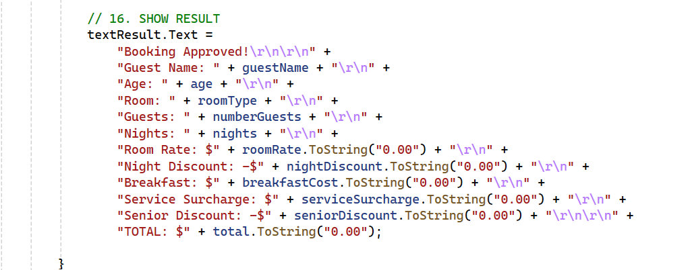

# Hotel Room Booking System

A simple **Hotel Room Booking System** developed using C# and Windows Forms. This application validates guest information, checks room capacity, calculates room charges, applies discounts, and displays the final booking result.

## Features

- Guest information validation
- Age validation (18–90 years)
- Number of nights validation (1–30 nights)
- Number of guests validation (1–6 guests)
- Room type selection and capacity validation
- Room rate calculation
- Night-based discounts
- Optional breakfast charges
- Service surcharge for more than four guests
- Senior citizen discount for guests aged 60 and above
- Booking approval and total cost display

## Technologies Used

- C#
- .NET Windows Forms
- Visual Studio

## Screenshots

### 1. Full Application Design

The main booking form before entering any information.

### 2. Input Validation

Validates whether the required guest information has been entered correctly.

### 3. Room Type Validation

Ensures that the user selects a room type before proceeding with the booking.

### 4. Full Design with Validation

An example of the application displaying validation messages when the input requirements are not met.

### 5. Discount Calculation Code

Shows the C# code responsible for calculating discounts based on the number of nights booked.

### 6. Result Code Panel

Shows the code responsible for displaying the booking details and final calculated cost.

## Room Rates

| Room Type | Price per Night | Maximum Guests |
|---|---:|---:|
| Standard | $50 | 2 |
| Normal | $80 | 4 |
| High | $130 | 6 |

## Discount Rules

| Condition | Discount |
|---|---:|
| 1–4 nights | No discount |
| 5–9 nights | 5% |
| 10–30 nights | 12% |
| Guest aged 60 or above | Additional 5% |

**Additional charges:**
- Breakfast: $10 per guest per night.
- Service surcharge: 5% when the number of guests exceeds four.

## How to Run

1. Clone or download this repository.
2. Open the project in Visual Studio.
3. Open the solution file (`.sln`).
4. Build the project.
5. Run the application.

## Author

**Mohamed Amin**

