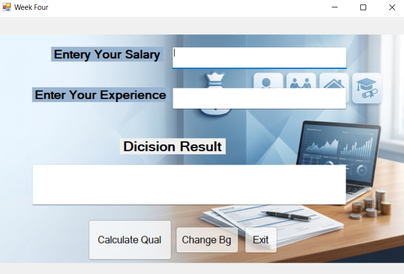
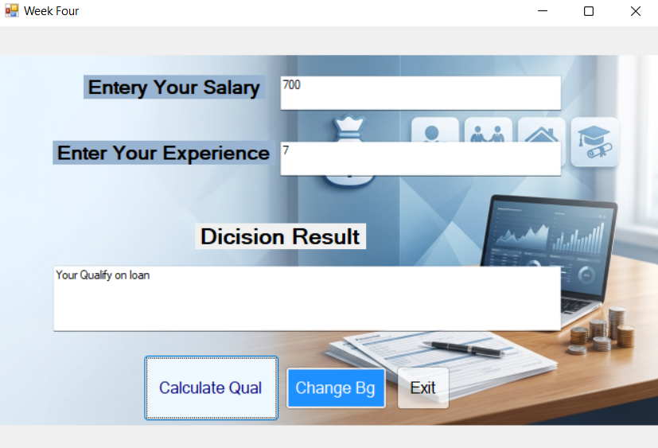
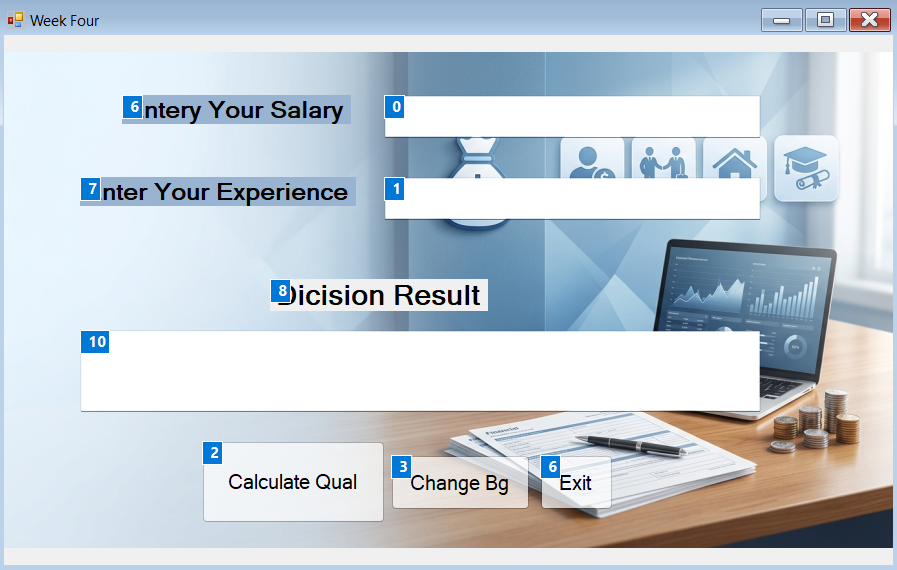
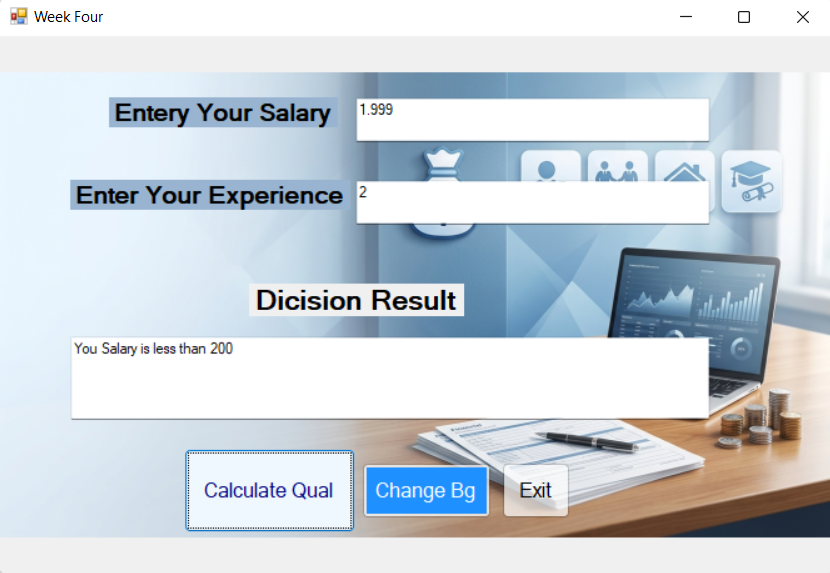
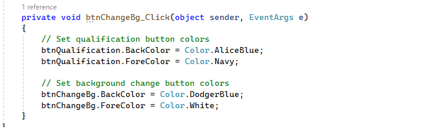
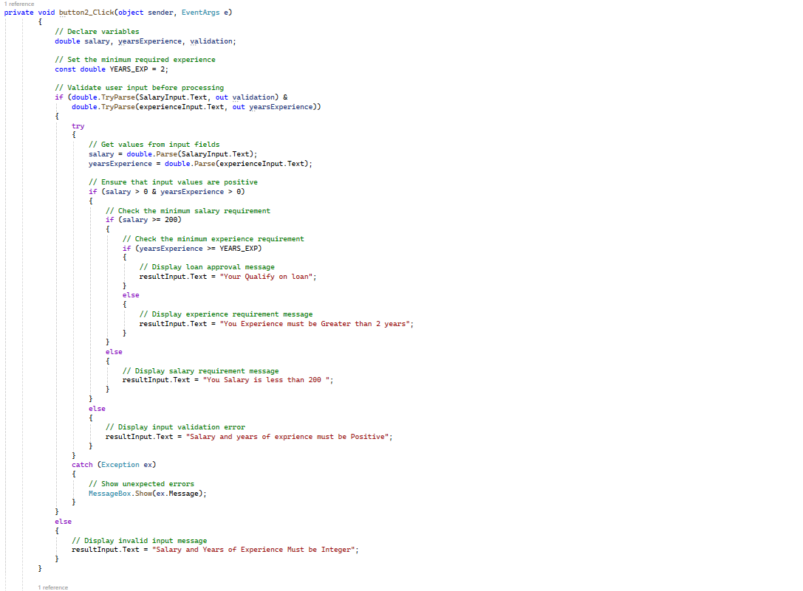

# LoanApp – C# Windows Forms

## Introduction

LoanApp is a simple loan qualification application developed using C# and Windows Forms. The application checks whether a user qualifies for a loan based on salary and years of work experience.

## Screenshots

### 1. Application Introduction

### 2. Background and Result

### 3. Tab Order

### 4. Background and Input Validation

### 5. Change Background Color Code

### 6. Try-Catch and Input Validation Code

## Features

* **Loan Qualification:** Checks whether the user meets the loan requirements.
* **Salary Validation:** Requires a salary of at least 200.
* **Experience Validation:** Requires at least 2 years of work experience.
* **Input Validation:** Uses `double.TryParse()` to validate numeric input.
* **Exception Handling:** Uses `try-catch` to handle unexpected errors.
* **Background Color Change:** Changes button background and foreground colors.
* **Tab Order:** Uses `TabIndex` to organize keyboard navigation.
* **Exit Button:** Closes the application.

## Technologies Used

* C#
* .NET Windows Forms
* Visual Studio

## Loan Qualification Requirements

| Requirement      | Condition                       |
| ---------------- | ------------------------------- |
| Salary           | 200 or greater                  |
| Work Experience  | 2 years or greater              |
| Input Validation | Values must be positive numbers |

The user qualifies for a loan when both the salary and work experience requirements are satisfied.

## How to Run

1. Clone or download this repository.
2. Open the project or solution file in Visual Studio.
3. Build the solution.
4. Run the application using `F5`.
5. Enter the salary and years of experience.
6. Click the qualification button to view the result.

## Learning Objectives

This project demonstrates fundamental C# programming concepts, including:

* Variables and constants
* Conditional statements (`if-else`)
* Numeric input validation
* Exception handling (`try-catch`)
* Windows Forms event handling
* Control properties and colors
* Keyboard navigation using `TabIndex`

## Author

**Mohamed Amin**
